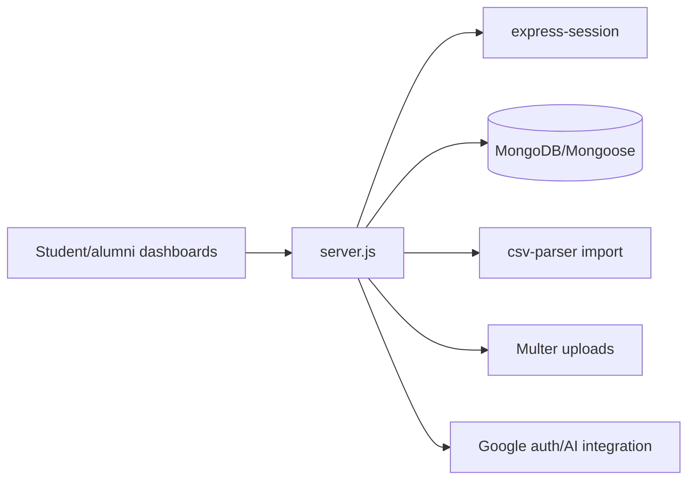

# PlacementPro

A Node.js/Express campus career suite for students and alumni. The application serves dashboard pages, uses MongoDB for placement data, supports CSV ingestion, file uploads, sessions, and Google/Gemini-related integration.

## Architecture



## Setup

```bash
npm ci
cp .env.example .env
npm start
# development (with nodemon installed)
npm run dev
```

Configure MongoDB, session secret, port, and any Google/AI credentials through environment variables. Do not use credentials embedded in deployment configuration.

## Workflow

The browser selects student, alumni, or administrative dashboards. Express authenticates requests, reads/writes placement records with Mongoose, imports structured CSV data, and handles document uploads. The HTML pages are the current client surface; route behavior lives in `server.js`.

## Deployment

Run `node server.js` on a Node.js 18+ service with a managed MongoDB database and persistent/controlled upload storage. Put the service behind HTTPS and configure secure session cookies.

## Testing and limitations

No automated test command is configured. Test role boundaries, session expiry, CSV validation, upload limits, and database failures before handling real student data.

## Security and operations

- Keep credentials, database URLs, OAuth tokens, API keys, and signing secrets in environment variables; never commit them.
- Validate and constrain uploaded files and user input at the server boundary, and enable HTTPS in production.
- Review dependency updates and rotate any credential that has appeared in repository history.

## Testing

The repository currently has no comprehensive automated test suite unless noted above. Before production changes, add tests for authentication/authorization, validation failures, persistence errors, and the primary user workflow.

## Limitations and roadmap

This is an actively evolving project. Production hardening, observability, rate limiting, backup/retention policy, and accessibility/performance validation should be completed before handling sensitive or high-volume workloads.

## License

See the repository license file and package metadata for the authoritative terms.
